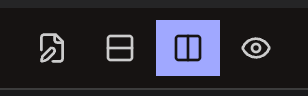
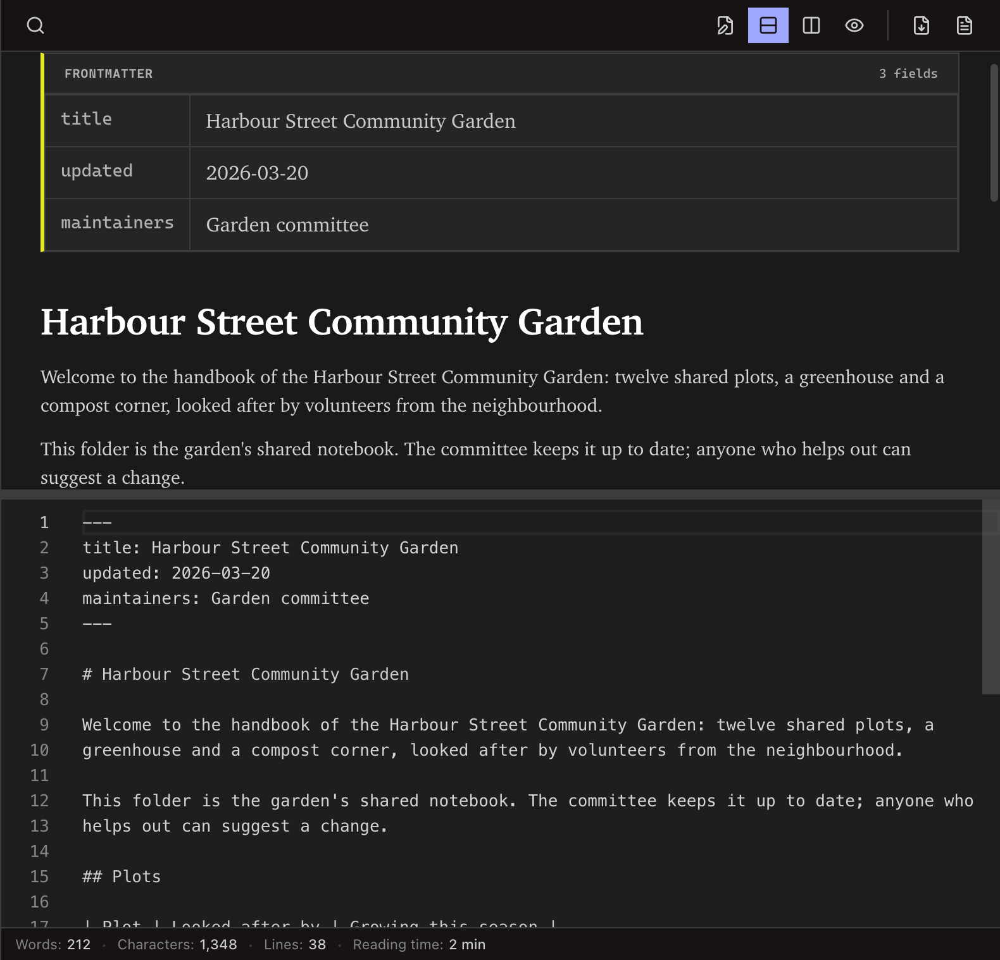
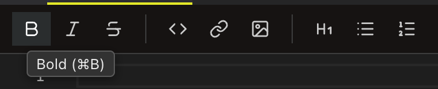
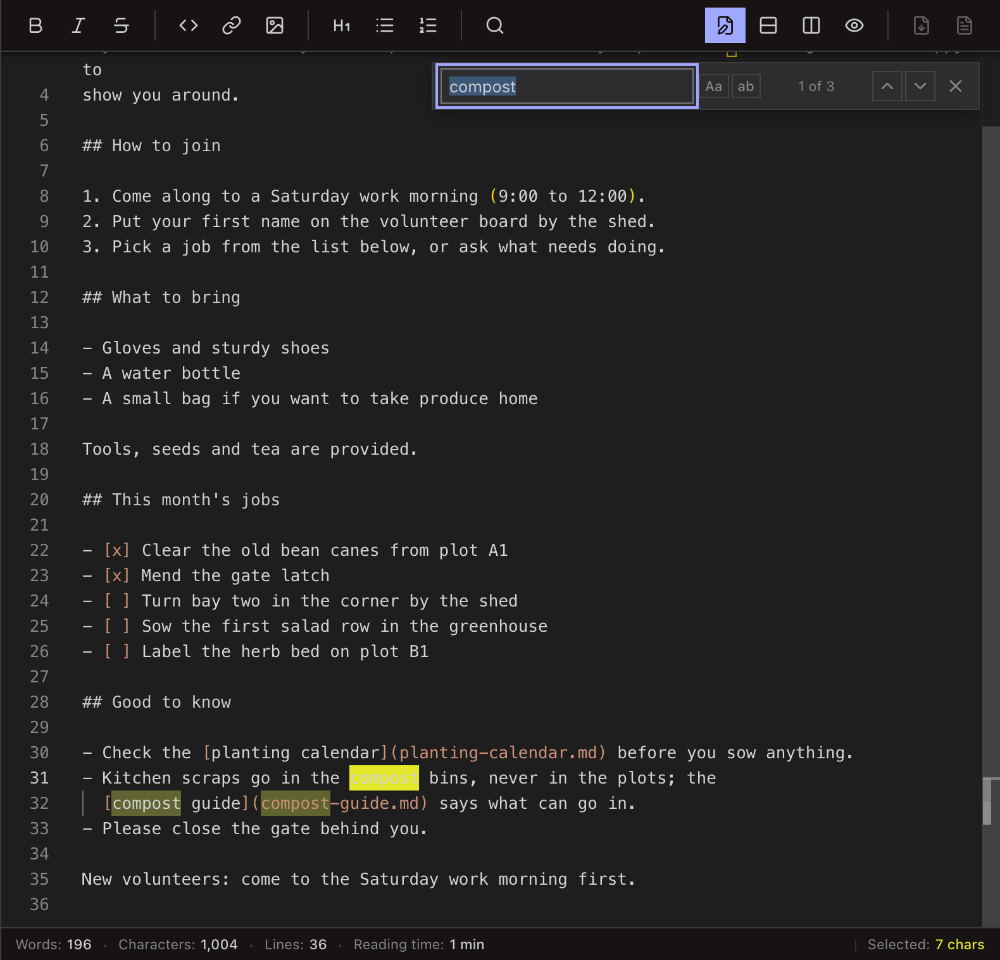
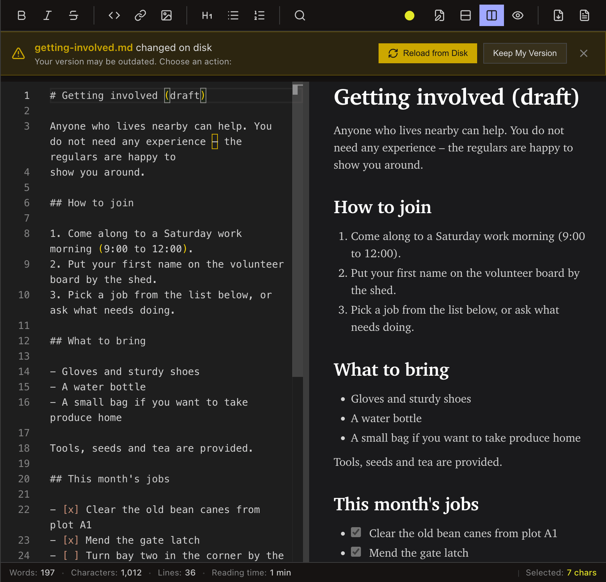
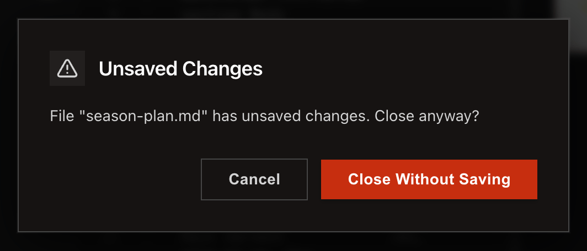

<!--
SPDX-License-Identifier: GPL-3.0-only
SPDX-FileCopyrightText: 2025-2026 Qodeca sp. z o.o.
-->

# Edit and preview Markdown

Use the view-mode buttons to work in the editor, preview, or both. Erfana autosaves 2 seconds after you stop typing. If a file changes outside Erfana while you have unsaved edits, choose **Reload from Disk** or **Keep My Version**. With no local edits, Erfana reloads the disk change automatically. The cross button (**Dismiss**) on that notice works like **Keep My Version**: it does not postpone the choice, and Erfana autosaves your text over the disk change about 2 seconds later.

**Before you start:** select a Markdown file in the project tree.

## Choose a view

1. Select **Editor Only**, **Split Horizontal (Preview Top)**, **Split Vertical (Side by Side)**, or **Preview Only** on the toolbar.
2. In **Editor Only** or **Split Vertical (Side by Side)**, use the formatting buttons, such as **Bold** (<kbd>⌘B</kbd> / <kbd>Ctrl+B</kbd>).
3. Select **Find** (<kbd>⌘F</kbd> / <kbd>Ctrl+F</kbd>) to search the open document.

## What happens next / If something goes wrong

If you close a tab with unsaved changes, Erfana asks first. Select **Close Without Saving** to discard them.

If the file is deleted on disk, the tab says so and autosave waits. If the file comes back, for example after a branch switch, a tab without edits shows it again on its own. If you typed meanwhile, choose **Reload from Disk** or **Keep My Version**. To write your version back while the file is gone, press <kbd>⌘S</kbd> / <kbd>Ctrl+S</kbd>. The notice's **Restore file** does the same, and **Close tab** closes the tab. Use [troubleshooting](../reference/troubleshooting.md) for an unavailable panel.

If the file becomes one Erfana cannot show – over 10 MB, binary, saved as UTF-16 or UTF-32, or locked so it cannot be read – the tab keeps the last text it showed, says why, becomes read-only and stops autosaving. Select **Reload** to try again when the notice offers it; otherwise the tab updates by itself with the next change to the file. If Erfana stops following a file, the notice says "Auto-refresh stopped" and **Reload** starts again. When too many files are open to follow them all live, or the file is on a network drive or in WSL, a notice says so; the tab then checks for changes when you switch to it or to the window.

## Related

- [Editor reference](../reference/editor.md)
- [Markdown preview reference](../reference/markdown-preview.md)
- [Comment on a preview](comment-on-a-preview.md) – comments in the **Preview Only** view
