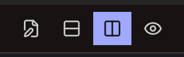
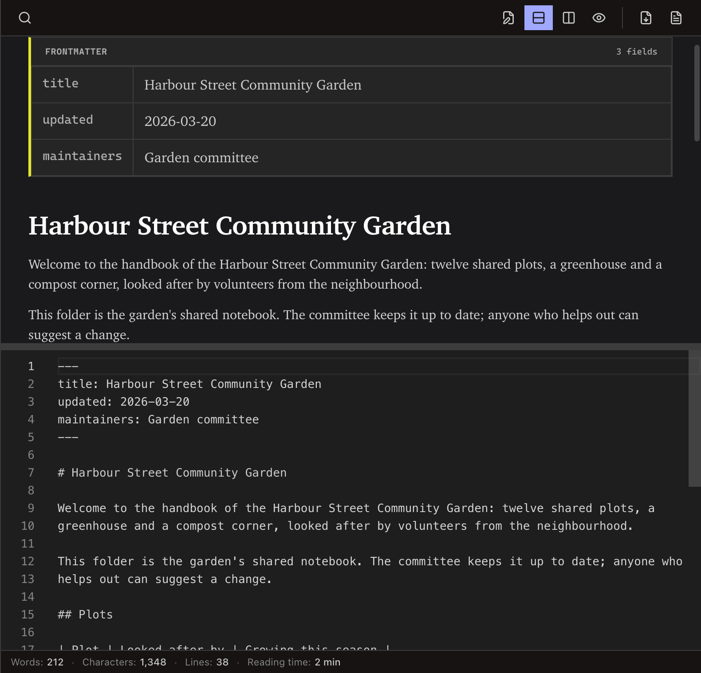
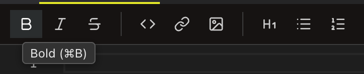
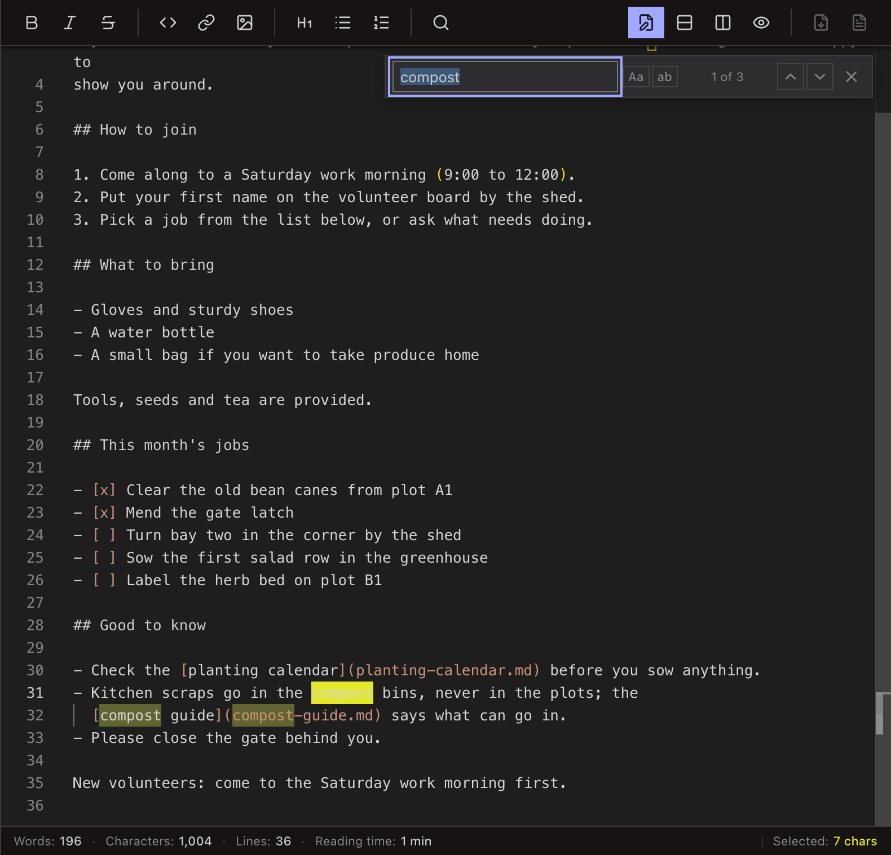
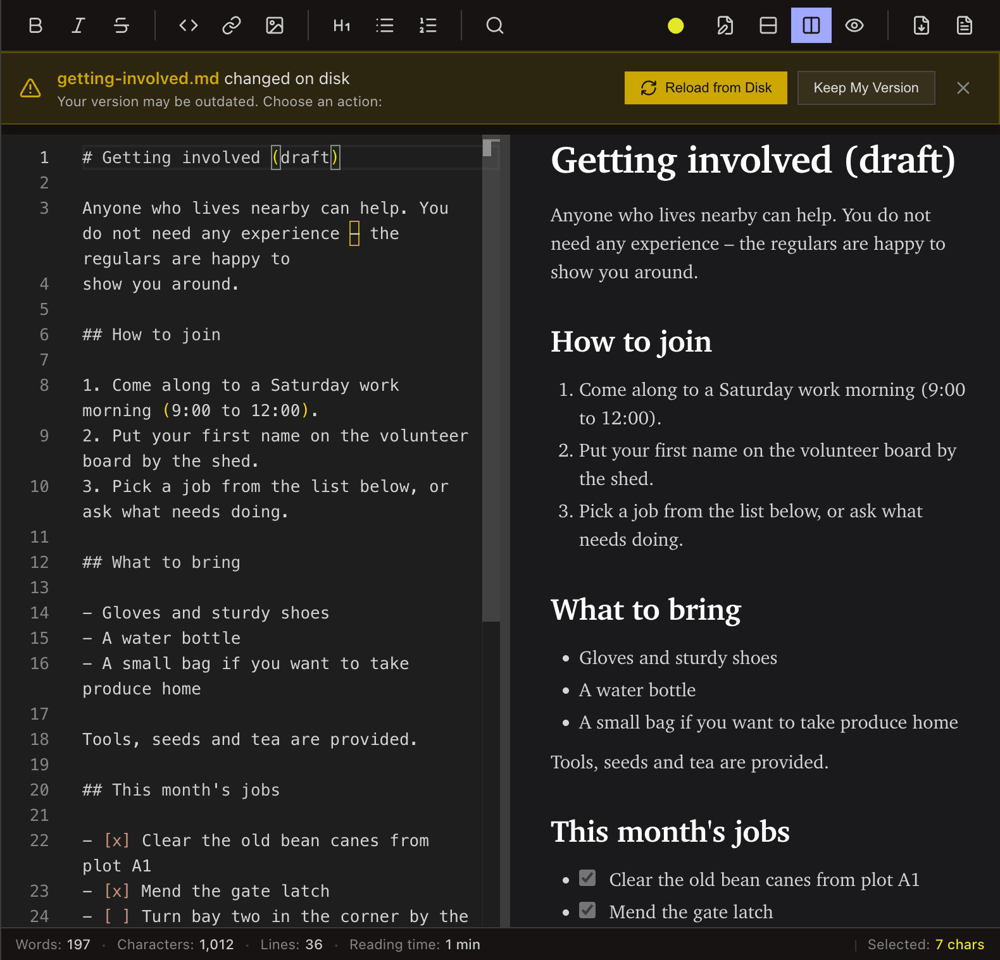
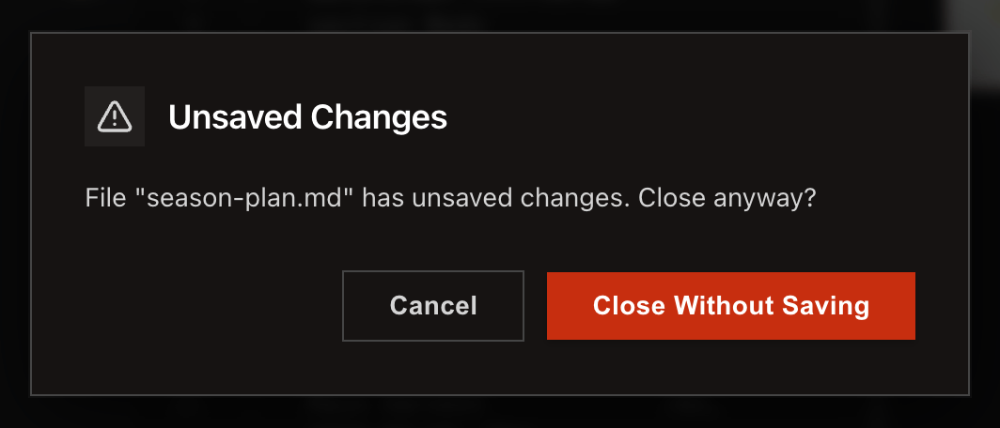

<!--
SPDX-License-Identifier: GPL-3.0-only
SPDX-FileCopyrightText: 2025-2026 Qodeca sp. z o.o.
-->

# Edit and preview Markdown

Use the view-mode buttons to work in the editor, preview, or both. Erfana autosaves 2 seconds after you stop typing. If a file changes outside Erfana while you have unsaved edits, choose **Reload from Disk** or **Keep My Version**. With no local edits, Erfana reloads the disk change automatically.

**Before you start:** select a Markdown file in the project tree.

## Choose a view

1. Select **Editor Only**, **Split Horizontal (Preview Top)**, **Split Vertical (Side by Side)**, or **Preview Only** on the toolbar.
2. In **Editor Only** or **Split Vertical (Side by Side)**, use the formatting buttons, such as **Bold** (<kbd>⌘B</kbd> / <kbd>Ctrl+B</kbd>).
3. Select **Find** (<kbd>⌘F</kbd> / <kbd>Ctrl+F</kbd>) to search the open document.

## What happens next / If something goes wrong

If you close a tab with unsaved changes, Erfana asks first. Select **Close Without Saving** to discard them. Use [troubleshooting](../reference/troubleshooting.md) for an unavailable panel.

## Related

- [Editor reference](../reference/editor.md)
- [Markdown preview reference](../reference/markdown-preview.md)
- [Comment on a preview](comment-on-a-preview.md) – comments in the **Preview Only** view
