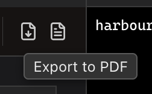

<!--
SPDX-License-Identifier: GPL-3.0-only
SPDX-FileCopyrightText: 2025-2026 Qodeca sp. z o.o.
-->

# Export to PDF or Word

Open a Markdown file in a split view or in preview only, then select **Export to PDF** or **Export to Word**.

**Before you start:** switch the Markdown file to **Split Horizontal (Preview Top)**, **Split Vertical (Side by Side)** or **Preview Only**. Export is unavailable in **Editor Only**.

## Export Markdown

1. Select **Export to PDF** or **Export to Word** on the toolbar.
2. Choose a destination in the system save dialog.
3. Find the saved document at the destination you chose. A **PDF exported** or **DOCX exported** message shows its file name. Erfana does not open it automatically.

> [!NOTE]
> Windows uses the same controls but a different save dialog.

## What happens next / If something goes wrong

HTML preview has its own **Export to PDF** button on its toolbar. See [troubleshooting](../reference/troubleshooting.md) if export cannot start.

## Related

- [Export reference](../reference/export.md)
