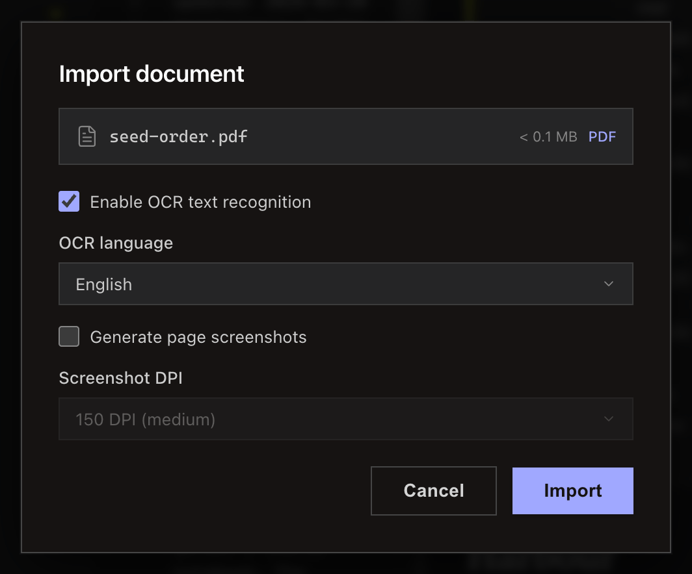
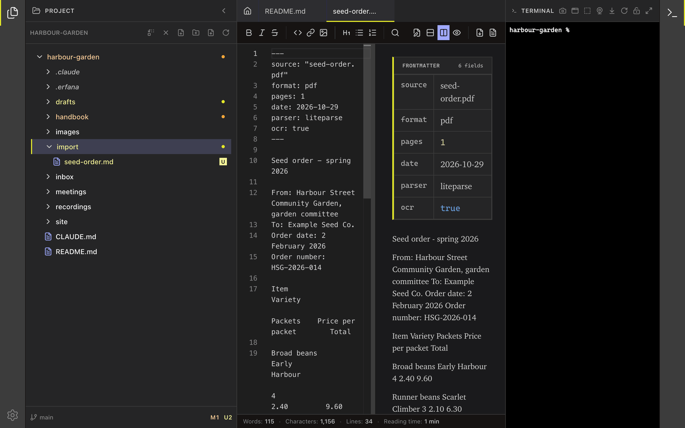

<!--
SPDX-License-Identifier: GPL-3.0-only
SPDX-FileCopyrightText: 2025-2026 Qodeca sp. z o.o.
-->

# Import a document

Start an import from the project tree, choose a file in your system's file picker, set OCR and page options, and Erfana converts it to a Markdown file.

**Before you start:** open the project folder that should receive the converted Markdown file.

## Import a file

1. Select **Import a file** in the tree toolbar, or right-click a folder and select **Import...**.
2. Choose the source document in the file picker. PDF, image and Office files open the **Import document** dialog.
3. Set **Enable OCR text recognition**, **OCR language**, **Generate page screenshots** and **Screenshot DPI**. Parsing covers at most 1,000 pages. Screenshots cover the first 100 pages only.
4. Select **Import**. The Markdown file is saved in the project's `import` folder, not in the folder you right-clicked, and page screenshots go under `import/screenshots/`. When it finishes, select **Done** to open the Markdown file. **Done** also sends the **Organize Import** prompt to the terminal. Start your agent first: with only a shell running, the shell runs the prompt as a command.

## What happens next / If something goes wrong

A plain-text file over 50 MB shows a **Large file warning** with **Import anyway** or **Skip**. PDF and image files need nothing extra. Word, PowerPoint, Excel and OpenDocument files need LibreOffice. If it is missing, the **LibreOffice required** message offers **Open import tools**, which shows how to install it. [Settings > Import tools](../reference/settings.md#import-tools) shows what works before you pick a file.

## Related

- [Import and transcription reference](../reference/import-and-transcription.md)
