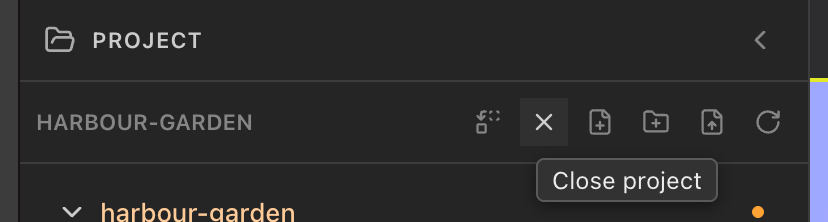

<!--
SPDX-License-Identifier: GPL-3.0-only
SPDX-FileCopyrightText: 2025-2026 Qodeca sp. z o.o.
-->

# Open a project

Open a folder to show its files and terminal. Select **Open project** on Home, then use **Change project** or **Close project** in the project header when needed.

**Before you start:** put the files you want to work on in one folder. Erfana opens folders, not individual files.

## Open a folder

1. Select **Open project** on Home.
2. Choose the folder in the system dialog.
3. Select a file in the project tree to open it.

## Change or close a project

1. Select **Change project** to choose another folder.
2. Select **Close project** to return to Home.
3. Select a recent project on Home to reopen it, or remove it from the list.

Before it switches or closes, Erfana saves every edited tab. It asks only about tabs it could not save, for example "1 tab could not be saved", or when the terminal shows recent activity. The dialog is titled **Unsaved Changes** or **Active Terminal Session**. **Switch Anyway** or **Close Anyway** goes ahead. **Cancel** keeps the current project open.

> [!NOTE]
> On Windows, the folder picker is different, but the Home and project-header controls are the same.

## What happens next / If something goes wrong

The terminal opens when a project loads. Erfana refuses the top of a drive, volume or network share, or a system folder, as a project – see [troubleshooting](../reference/troubleshooting.md#a-folder-cannot-be-opened-as-a-project). If the tree is unavailable, use [troubleshooting](../reference/troubleshooting.md#project-tree-unavailable).

## Related

- [Project tree reference](../reference/project-tree.md)
- [Work in several windows](work-in-several-windows.md)
