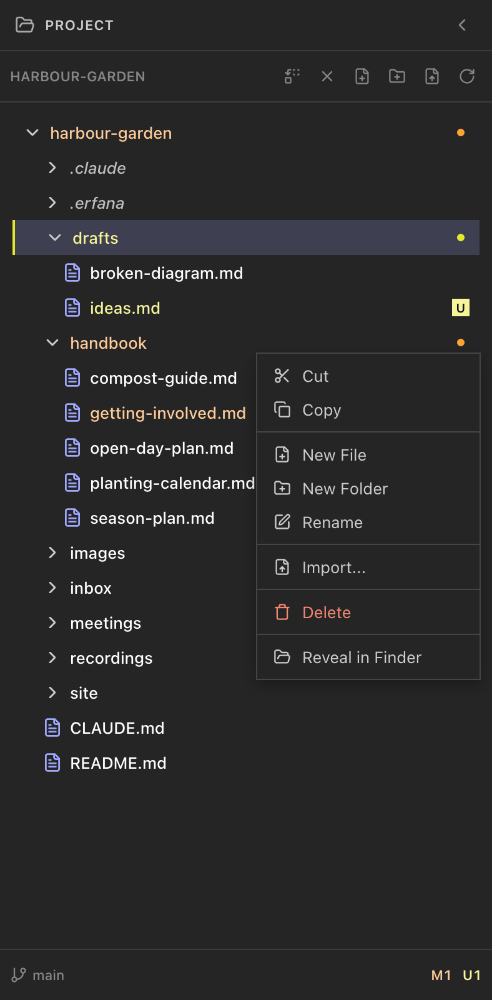
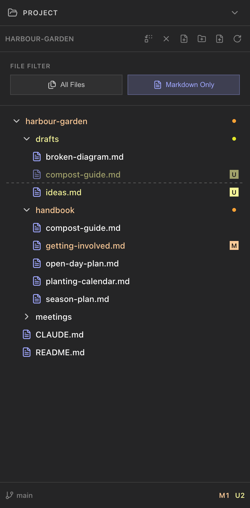
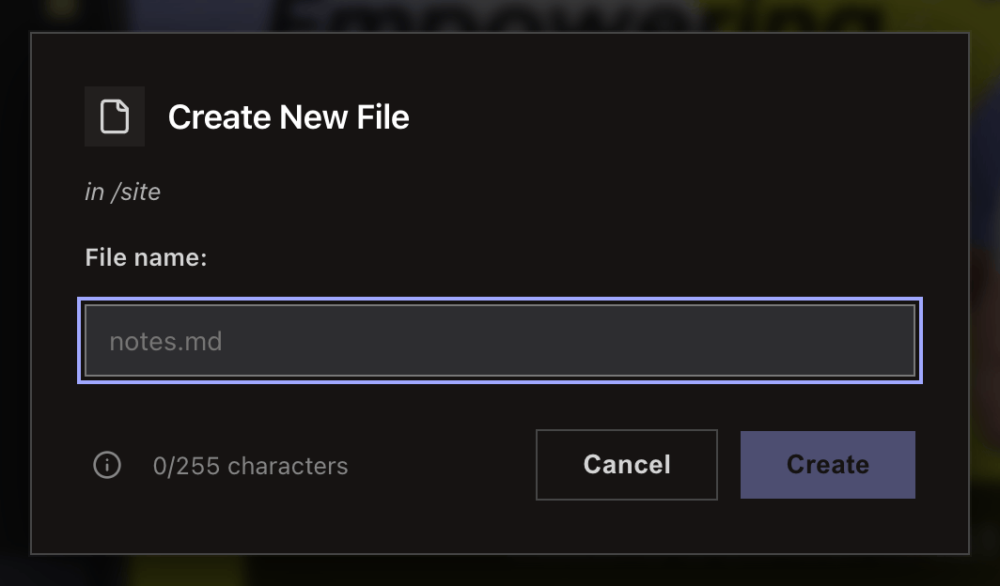
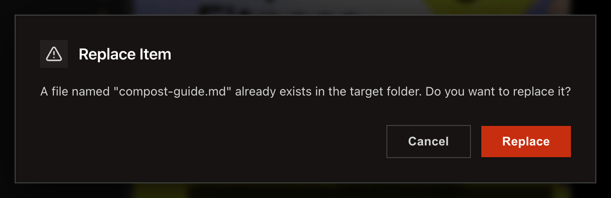
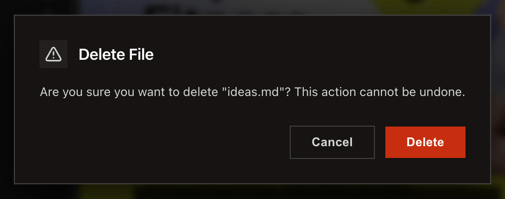

<!--
SPDX-License-Identifier: GPL-3.0-only
SPDX-FileCopyrightText: 2025-2026 Qodeca sp. z o.o.
-->

# Organise project files

Use the project tree to create, move, rename, import, or delete files.

**Before you start:** open a project and select the destination folder.

## Manage files

1. Use the tree toolbar buttons **Create new markdown file**, **Create new folder**, **Import a file**, and **Refresh**. New files and folders go into the selected folder, or the project root if none is selected.
2. Right-click a file or folder for **Cut**, **Copy**, **Rename**, **Delete**, and **Reveal in Finder** (Windows: **Reveal in Explorer**; Linux: **Reveal in File Manager**). **Paste** appears on folders when the clipboard has items.
3. Drag a file to a folder to move it. For a Finder or File Explorer drop, choose **Move**, **Copy**, or **Import** (shown only when a dropped file can be imported). **Move** asks once more, in a box that names the files, because the originals are removed from their folders; **Cancel** moves none of them.
4. Add at most 100 files at a time. A larger drop is refused with **Too many files** before you are asked how to add it.

## What happens next / If something goes wrong

Deletion cannot be undone. If a dropped file's name already exists, the **File already exists** box offers **Skip**, **Keep both**, or **Replace**. A name cannot contain `/ \ : * ? " < > |`. Keyboard users can open the same row menu with <kbd>⇧F10</kbd> / <kbd>Shift+F10</kbd>, or the Menu key – see [keyboard navigation](../reference/project-tree.md#keyboard-navigation).

## Related

- [Project tree reference](../reference/project-tree.md)
- [Menus reference](../reference/menus.md)
