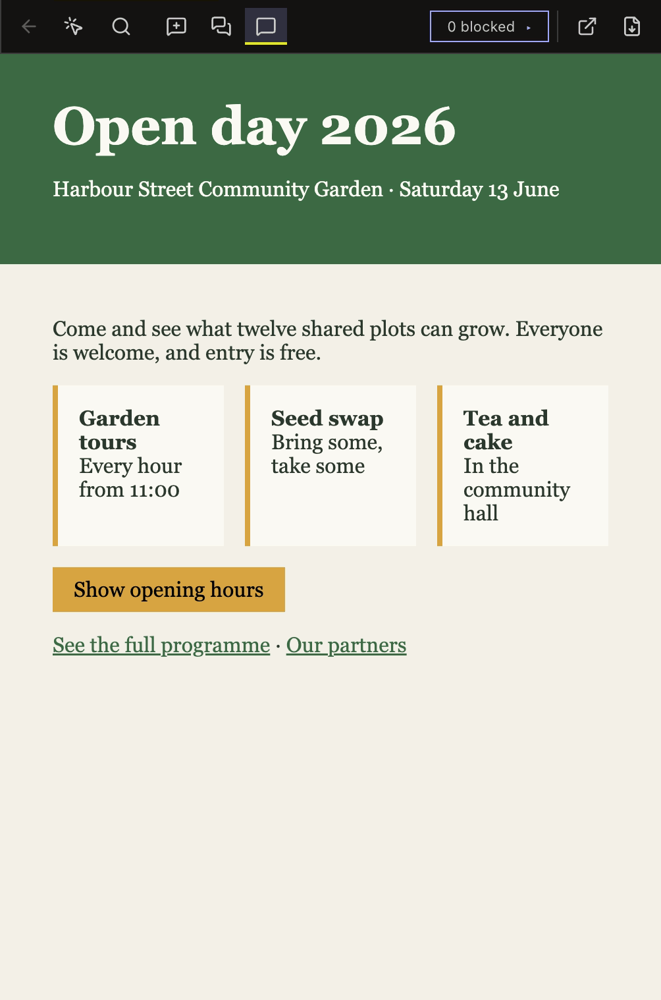
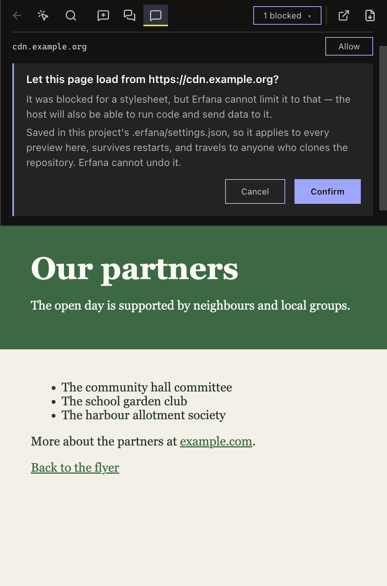
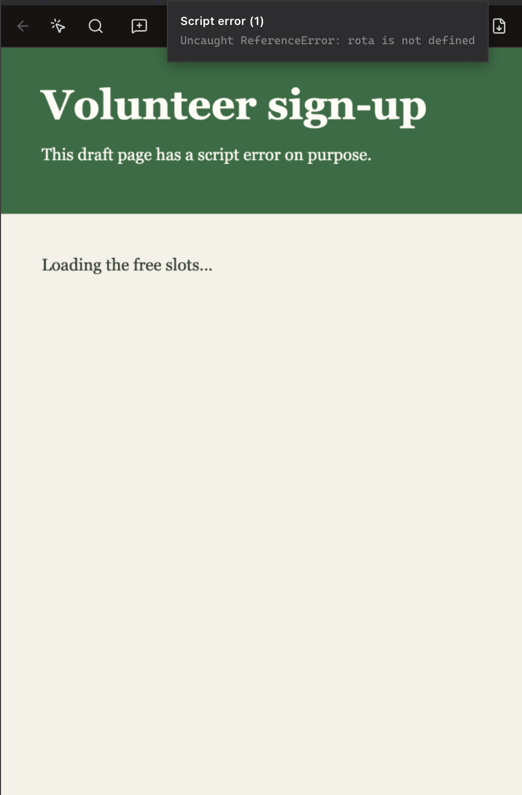
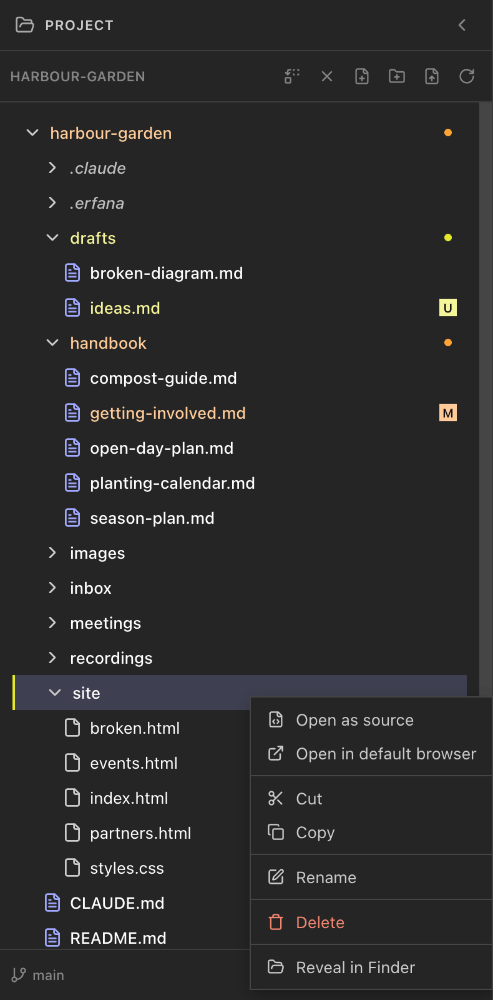

<!--
SPDX-License-Identifier: GPL-3.0-only
SPDX-FileCopyrightText: 2025-2026 Qodeca sp. z o.o.
-->

# Preview an HTML page

Open an HTML file to run its page in Erfana. Approve a remote host only when you trust it.

**Before you start:** check that **Run HTML files** is on in **Settings** > **HTML preview**. It is on by default.

## Open and navigate a page

1. Select an HTML file in the project tree. It opens as a running page.
2. To see the code instead, right-click the file and choose **Open as source**.
3. Use the preview toolbar: **Back**, **Find**, **Open in default browser** and **Export to PDF**.
4. For a remote host, select the blocked count in the toolbar, such as **1 blocked · 0 allowed**. Then select **Allow**, and **Confirm** only after reviewing the host.

> [!NOTE]
> Approved remote hosts are saved in the project's `.erfana/settings.json`. You cannot remove them in the app.

## Comment on an element

1. Select **Comment mode** in the toolbar, or press <kbd>⌥⌘M</kbd> / <kbd>Ctrl+Alt+M</kbd>.
2. Select an element, or right-click it and choose **Add comment**. The first time, enter your name in **Before your first comment** and select **Continue**.
3. Type the comment and select **Save**. It is saved inside the `.html` file, and a pin marks the element.

To comment on selected words, find and sort comments, or step through them, see [Comment on a preview](comment-on-a-preview.md). See also [HTML preview reference § Comments](../reference/html-preview.md#comments).

## What happens next / If something goes wrong

Select the issue count on the preview tab. It lists each problem the page hit, such as script errors, blocked hosts, blocked links and refused frames. If the preview stops running, select **Reload**.

## Related

- [HTML preview reference](../reference/html-preview.md)
- [Settings reference](../reference/settings.md)
