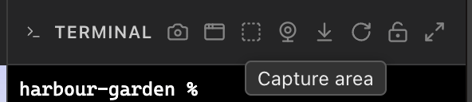
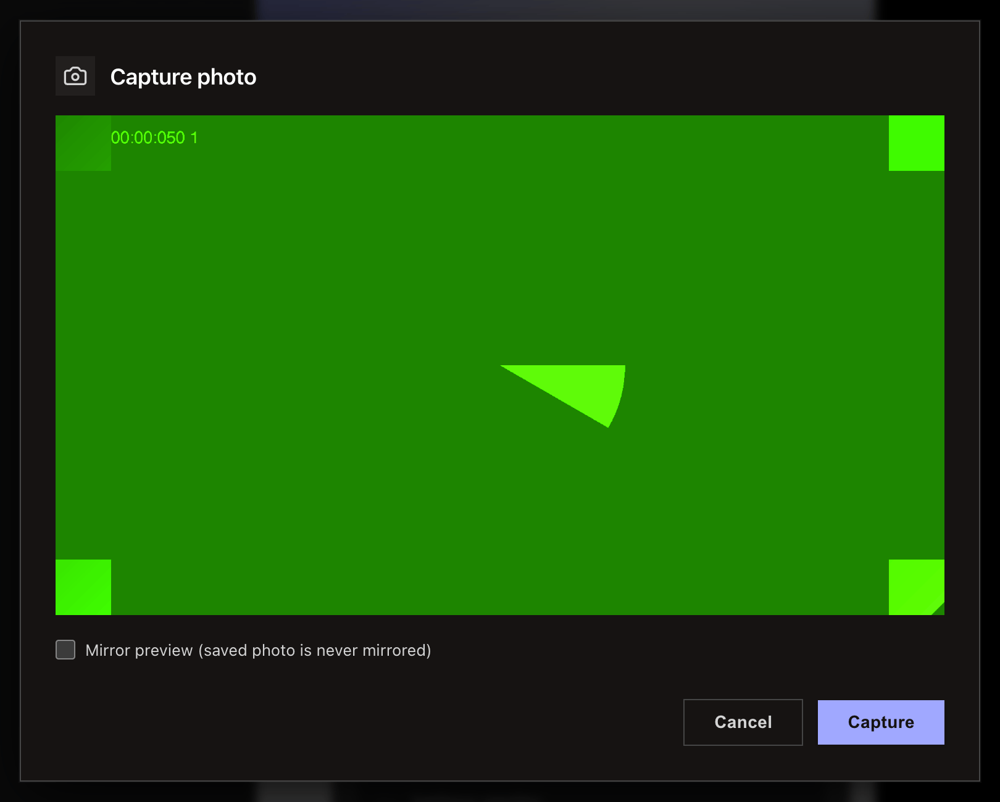

<!--
SPDX-License-Identifier: GPL-3.0-only
SPDX-FileCopyrightText: 2025-2026 Qodeca sp. z o.o.
-->

# Send a screenshot or photo to the agent

Use the capture buttons in the terminal header to take a screenshot or a camera photo. Erfana pastes the image's file path into the terminal for your agent.

**Before you start:** open the terminal – the capture buttons appear only while a terminal is running. On macOS, screenshots need Screen Recording enabled for Erfana in System Settings.

## Capture an image

1. Select **Capture screen**, **Capture window** or **Capture area** in the terminal header.
2. Choose what to capture. If more than one display is connected, **Capture screen** opens **Select display** – select a display, then select **Capture**.
3. Erfana pastes the quoted file path into the terminal for your agent.
4. Select **Capture photo**, then select **Capture** in the dialog to take a JPEG photo. If several cameras are available, choose one in the dialog. **Mirror preview (saved photo is never mirrored)** is remembered per camera and changes only the preview. Erfana pastes the photo's file path into the terminal.

> [!NOTE]
> Screen, window and area capture work on macOS and Windows. On macOS, window and area capture use the system picker. On Windows, Erfana shows its own window picker and area overlay.

## What happens next / If something goes wrong

If macOS blocks a screenshot, Erfana shows **Screen Recording permission needed**. Select **Open Screen Recording settings**, allow Erfana, then select **Relaunch Erfana** and try again.

## Related

- [Terminal reference](../reference/terminal.md)
- [Windows differences](../reference/windows-differences.md)
