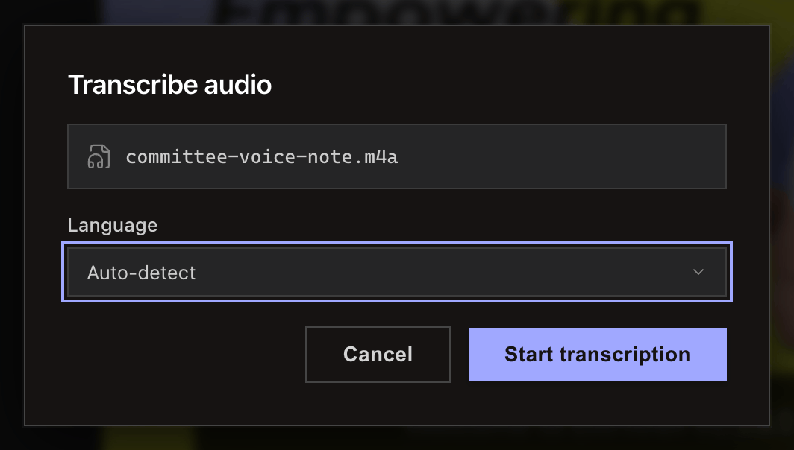

<!--
SPDX-License-Identifier: GPL-3.0-only
SPDX-FileCopyrightText: 2025-2026 Qodeca sp. z o.o.
-->

# Transcribe audio or video

Turn one audio or video file into a Markdown transcript. The **OpenAI** backend sends the audio to the OpenAI API. The **Local (whisper.cpp)** backend runs on your computer once its model is downloaded.

**Before you start:** open a project. In **Settings**, under **Transcription**, choose a **Backend**:

- **OpenAI** – enter your key in **OpenAI API key**.
- **Local (whisper.cpp)** – pick a **Whisper model**, then select **Download model**.

## Transcribe media

1. In the project tree, select the **Import a file** toolbar button, or right-click a folder and choose **Import...**.
2. In the system picker, choose one audio or video file. Erfana opens the **Transcribe audio** or **Transcribe video** dialog.
3. Under **Language**, choose a language or **Auto-detect**.
4. Select **Start transcription**.
5. When the dialog shows **Transcription complete**, select **Done**. Erfana opens the Markdown transcript, saved in the project's `import/` folder.

> [!NOTE]
> Local transcription runs on macOS and Windows x64 only. It is not available on Windows ARM64 or Linux; use the **OpenAI** backend there.

## What happens next / If something goes wrong

- If transcription fails, select **Retry**, or **Dismiss** to close the dialog.
- Recordings longer than 8 minutes are split into chunks. The progress line shows which chunk is running.
- To stop a model download, select **Cancel** in Settings. The partial download is deleted.
- Import audio and video files one at a time. A batch import skips media files.

## Related

- [Import and transcription reference](../reference/import-and-transcription.md)
- [Settings reference](../reference/settings.md)
