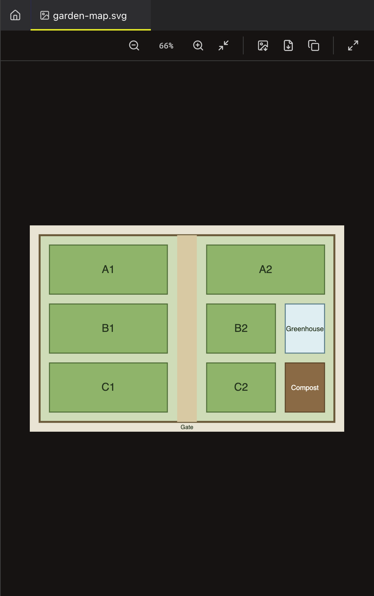
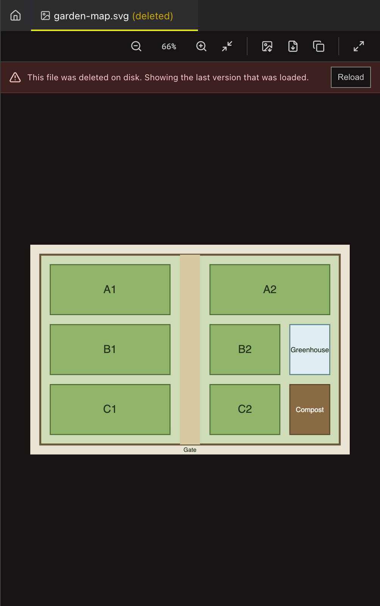

<!--
SPDX-License-Identifier: GPL-3.0-only
SPDX-FileCopyrightText: 2025-2026 Qodeca sp. z o.o.
-->

# View and export images

Open an image from the project tree, then zoom, fit, export, or copy it from the viewer toolbar.

**Before you start:** select a supported image file in an open project.

## View and export an image

1. Select the image in the tree. It opens in the image viewer.
2. Use **Zoom in**, **Zoom out**, **Fit to view**, or **Full screen** to inspect it. Drag the image to pan.
3. Select **Export as PNG** or **Export as PDF** to save a copy, or **Copy to clipboard** to copy it.

## What happens next / If something goes wrong

The viewer refreshes files that change on disk and shows **Reloaded from disk**. If a file is deleted, a banner says "This file was deleted on disk." Restore the file, then select **Reload**.

## Related

- [Image viewer reference](../reference/image-viewer.md)
- [Export reference](../reference/export.md)
