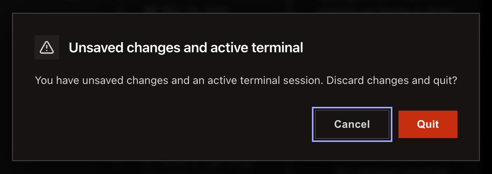

<!--
SPDX-License-Identifier: GPL-3.0-only
SPDX-FileCopyrightText: 2025-2026 Qodeca sp. z o.o.
-->

# Work in several windows

Select **File > New Window** (<kbd>⇧⌘N</kbd> / <kbd>Ctrl+Shift+N</kbd>) to open another window. Opening a project that is already open in another window focuses that window instead.

On macOS, the Erfana Dock menu also offers **New Window**. On Windows, select **New Window** from Erfana's taskbar jump list. Both routes open a separate Erfana instance, like **File > New Window**.

**Before you start:** save work you do not want to lose. Quitting from the app menu, or with **File > Exit** on Windows, closes Erfana without a confirmation.

## Open and close windows

1. Select **File > New Window** or press <kbd>⇧⌘N</kbd> / <kbd>Ctrl+Shift+N</kbd>.
2. Open one project in each window as needed.
3. Close the window.
4. Review the confirmation. It appears when a file has unsaved changes, or when the terminal you typed in showed activity in the last 20 seconds.

## What happens next / If something goes wrong

Select **Cancel** in the confirmation to return to the window and save files. Select **Quit** to discard unsaved changes and quit. A crash recovery screen is covered in [troubleshooting](../reference/troubleshooting.md).

## Related

- [The Erfana window](../reference/the-erfana-window.md)
- [Files Erfana keeps](../reference/files-erfana-keeps.md)
