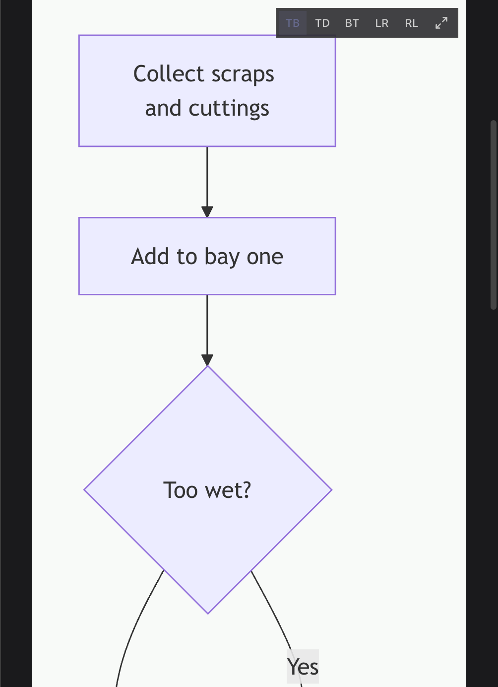
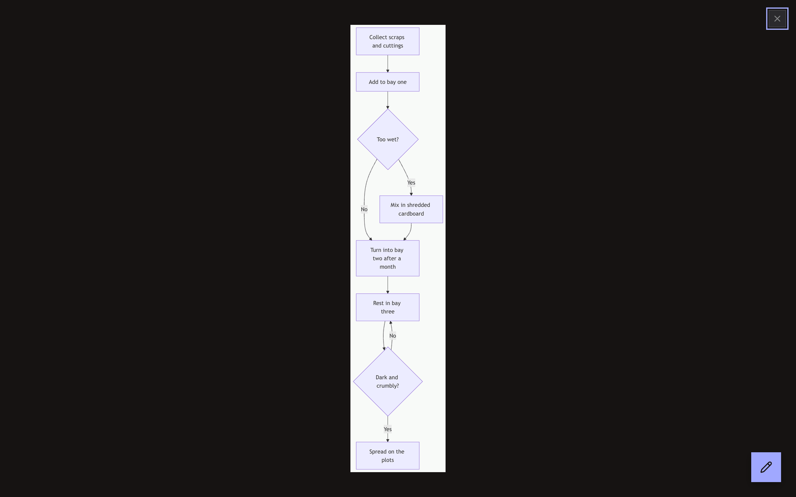
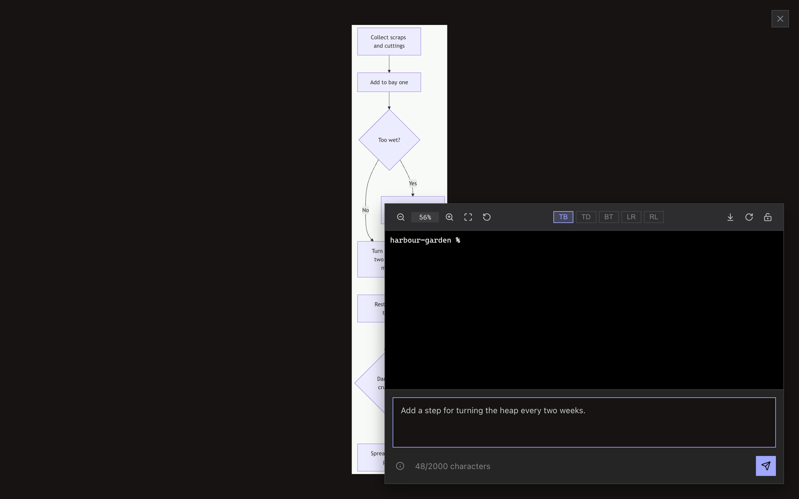

<!--
SPDX-License-Identifier: GPL-3.0-only
SPDX-FileCopyrightText: 2025-2026 Qodeca sp. z o.o.
-->

# Work with Mermaid diagrams

Write a Mermaid code block in Markdown, then use the diagram toolbar to change direction or open the viewer.

**Before you start:** open a Markdown file in **Split Vertical**, **Split Horizontal** or **Preview Only** view.

## View a diagram

1. Add a Mermaid code block to the document.
2. To change the layout, select a direction button such as **TB** or **LR** in the diagram toolbar. The buttons appear only for diagram types that support a direction. Erfana sends a prompt to the terminal, and the agent there rewrites the block.
3. Select **View fullscreen** to open the diagram viewer.
4. Zoom with the mouse wheel or the keys <kbd>+</kbd> and <kbd>-</kbd>. Press <kbd>F</kbd> to fit the diagram to the screen and <kbd>0</kbd> to reset the view.
5. To change the diagram in words, select **Edit diagram** in the viewer. Type an instruction, then select **Send message** or press <kbd>⌘Enter</kbd> / <kbd>Ctrl+Enter</kbd>.

## What happens next / If something goes wrong

If a diagram cannot render, the preview shows a **Mermaid Diagram Error:** box. Select its bug button, **Report this error to Claude Code**, to send a fix prompt to the terminal. The agent edits the diagram block in the file in place; review its edits and the rendered result. See [troubleshooting](../reference/troubleshooting.md).

## Related

- [Markdown preview reference](../reference/markdown-preview.md)
- [Prompt templates reference](../reference/prompt-templates.md)
