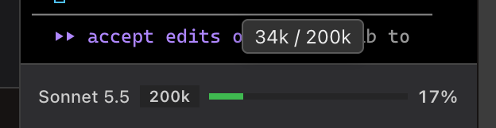

<!--
SPDX-License-Identifier: GPL-3.0-only
SPDX-FileCopyrightText: 2025-2026 Qodeca sp. z o.o.
-->

# Read Claude Code status

The terminal's context meter appears only while Claude Code runs. It reads Claude Code's transcripts and the `model` value in `~/.claude/settings.json`. It never writes Claude Code configuration. Erfana's terminal can run other CLI agents without this meter.

**On this page**

- [Model and context meter](#model-and-context-meter)
- [Model name](#model-name)
- [How the window size is chosen](#how-the-window-size-is-chosen)
- [Tooltip and limits](#tooltip-and-limits)

## Model and context meter

**What it does:** Shows the detected model, a window-size badge (**200k** or **1M**), an estimated context-use percentage and a coloured bar. Below 30% is the low range, 30–60% the middle range, and 60% or above the high range. **How to reach it:** start `claude` in the terminal. The bar appears once the session has written its first reply. It is informational; it does not change the agent's context window.

## Model name

The meter turns the model id from the transcript into a short name:

- A Claude id shows as family and version, without a snapshot date or a bracket suffix. For example, `claude-opus-5` shows as **Opus 5** and `claude-haiku-4-5-20251001` as **Haiku 4.5**.
- Cloud-platform ids show the same name and get the same window as the plain id. This covers Amazon Bedrock ids that start with `anthropic.`, with or without a region prefix (`us.`, `eu.`, `apac.`, `jp.`, `au.`, `global.` or `us-gov.`) and a version ending such as `-v1:0`. It also covers Bedrock inference-profile and foundation-model ARNs, and Google Vertex ids that end in `@` and a date. Microsoft Foundry uses the plain id.
- A bare family name such as `opus` shows as **Opus**. It names no version, so the built-in table cannot size its window.
- `claude-mythos-preview` shows as written.
- Any other id shows as written, with control and invisible characters removed and cut to 64 characters. In an ARN, the 12-digit AWS account number is replaced with `[redacted-account]`. An application inference profile ARN names no model, so the meter cannot read it.

For an id the meter cannot read, the **200k** window is a guess, and the tooltip marks it **(inferred)**.

Related issues: [#41](https://github.com/qodeca/erfana/issues/41), [#49](https://github.com/qodeca/erfana/issues/49).

## How the window size is chosen

Claude Code's transcript does not record the window size, so the meter works it out. It checks these rules in order, and the first match wins:

1. The session has used more than 200k tokens: **1M**, because a 200k window cannot hold that much.
2. You picked a model in this session with `/model` and the name ends in `[1m]`: **1M**.
3. You picked a model in this session with `/model` without `[1m]`: **200k**.
4. The built-in model table below lists the model at 1M: **1M**.
5. The `model` value in `~/.claude/settings.json` contains `[1m]`: **1M**.
6. Otherwise: **200k**.

| Model | Window in the built-in table |
| --- | --- |
| Opus 4.5, Opus 4.6 | 200k |
| Opus 4.7, Opus 4.8, Opus 5 | 1M |
| Sonnet 4.5, Sonnet 4.6 | 200k |
| Sonnet 5 | 1M |
| Haiku 4.5 | 200k |
| Fable 5, Mythos 5, Mythos Preview | 1M |

For a model not in the table, the meter makes a bounded guess:

- A newer point release, up to four steps past the newest listed one, takes that version's window. For example, Opus 5.1 to Opus 5.4 count as 1M.
- The next major version takes the family's newest window. For example, Opus 6 counts as 1M and Haiku 5 as 200k.
- Anything further out, such as Opus 5.5, Sonnet 5.5 or Opus 7, gets no table answer. An older unlisted version gets none either. These fall through to rules 5 and 6, so they show **200k** until the session passes 200k tokens.

Once the window is **1M** because of rule 1, rule 2, rule 5, or a `[1m]` ending on the id itself, it stays **1M** for that model for the rest of the session. A model switch or a `/model` pick without `[1m]` resets it.

The only Claude Code setting the meter reads is that `model` value; it reads the file and never writes it. It does not read environment variables. Erfana also removes `CLAUDE_CODE_*` variables it inherited from its own launch environment before it starts a terminal. The meter has no rule for setups that cap the 1M window, such as `CLAUDE_CODE_DISABLE_1M_CONTEXT`, so they can still show **1M**; see [issue #48](https://github.com/qodeca/erfana/issues/48).

Related issues: [#41](https://github.com/qodeca/erfana/issues/41), [#48](https://github.com/qodeca/erfana/issues/48), [#383](https://github.com/qodeca/erfana/issues/383).

## Tooltip and limits

**What it does:** Hover the bar for token counts, rounded to thousands, and the detected context-window size (for example `84k / 200k`). If the window size was inferred, the tooltip adds **(inferred)**. That happens when **1M** comes only from the built-in table, or when **200k** is the default for an id the meter cannot read. **How to reach it:** pointer over the Claude Code status area. The meter works on macOS and Windows only; on Linux it never appears. On Windows, the meter follows the folder the terminal started in, not a later `cd`, so status can disappear after changing directory before starting `claude`; the terminal session itself continues. Meter values depend on the available Claude Code transcript format and can be unavailable without affecting the terminal.

The screenshot shows the bar; its native hover tooltip is not captured in the image.
