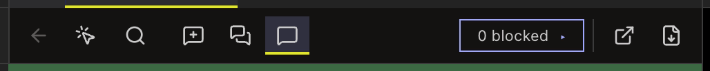

<!--
SPDX-License-Identifier: GPL-3.0-only
SPDX-FileCopyrightText: 2025-2026 Qodeca sp. z o.o.
-->

# Preview an HTML page

HTML preview runs a project page with its CSS and JavaScript in a sandboxed view. It is on by default; [**Run HTML files**](settings.md#html-preview) can turn it off so files open as source.

**On this page**

- [Opening and limits](#opening-and-limits)
- [Toolbar and navigation](#toolbar-and-navigation)
- [Remote-host permission](#remote-host-permission)
- [Live refresh and frames](#live-refresh-and-frames)
- [Find, issues and stopped state](#find-issues-and-stopped-state)
- [Zoom and PDF](#zoom-and-pdf)
- [Comments](#comments)

## Opening and limits

**What it does:** Select an HTML file to run it. Files in `node_modules`, `dist`, `out`, `coverage` or `.git`, git-ignored files, and files outside the project open as source. At most three pages run at once; other previews freeze to a still image until active again. **How to reach it:** select a project `.html` file. See [the walkthrough](../how-to/preview-an-html-page.md).

A Markdown preview is static: its sanitizer removes scripts, event handlers and iframes. An HTML preview runs the page's own scripts. Pages that need a build step or a dev server do not run as-is. A bare import such as `import 'react'` fails and shows as **Unresolved import** in Preview issues.

A page in a dot-prefixed folder, such as `.claude/` or `.agents/`, does not load. The preview refuses any path with a segment that starts with a dot, and Preview issues shows **Excluded path**. The same applies to files the page loads from such folders.

Related issues: [#74](https://github.com/qodeca/erfana/issues/74), [#234](https://github.com/qodeca/erfana/issues/234), [#254](https://github.com/qodeca/erfana/issues/254).

## Toolbar and navigation

**What it does:** **Back** returns to the previous page; **Open links in this tab** changes link behavior; **Find** searches the page; the permission chip shows remote-host status; **Open in default browser** opens the page outside Erfana; **Export to PDF** saves it. **How to reach it:** toolbar above the page. Back and Forward are <kbd>⌘[</kbd> and <kbd>⌘]</kbd> / <kbd>Alt+←</kbd> and <kbd>Alt+→</kbd>. The tab keeps up to 50 history entries; external links ask before opening.

With **Open links in this tab** off, the default, a plain link opens the target page in a new tab. With it on, a link replaces this page. Every tab starts in new-tab mode again after a restart.

Related issues: [#122](https://github.com/qodeca/erfana/issues/122).

## Remote-host permission

**What it does:** A page requesting a remote host shows a permission band. Select **Allow**, then **Confirm** to approve it for this project. **How to reach it:** the band above the page. Approved origins are saved in `.erfana/settings.json`; there is no in-app revoke control. This approval is separate from the global **Run HTML files** switch.

- **What is approved:** an origin – scheme, host and port, such as `https://cdn.example.com` or `http://localhost:8080`. Plain `http://`, IP addresses, `localhost` and single-label names can be approved.
- **What it allows:** the origin can serve scripts, stylesheets, images, fonts and media to the page, and the page can send requests to it. It is never allowed as a frame.
- **Who it applies to:** every HTML page in the project. If `.erfana/settings.json` is committed, everyone who clones the project gets the same approval.
- **To revoke:** remove the origin from `htmlPreview.allowlist.origins` in `.erfana/settings.json`, then close and reopen the preview. The list is read each time a preview opens.
- **Hosts that cannot be approved:** IPv6 addresses and names with an invalid part, such as an underscore or an empty part. Their row shows the reason, for example **IPv6 cannot be allowed** or **Not a valid host name**, and has no **Allow** button.
- **Invalid file:** if `.erfana/settings.json` cannot be read or parsed, or its allowlist block is invalid, Preview issues shows **Invalid allowlist host** and no origin is approved. An unknown allowlist version shows **Unsupported allowlist version**. Fix the file, then reopen the preview.

Related issues: [#77](https://github.com/qodeca/erfana/issues/77), [#81](https://github.com/qodeca/erfana/issues/81), [#86](https://github.com/qodeca/erfana/issues/86), [#108](https://github.com/qodeca/erfana/issues/108), [#115](https://github.com/qodeca/erfana/issues/115), [#116](https://github.com/qodeca/erfana/issues/116).

## Live refresh and frames

**What it does:** A change to a single stylesheet refreshes in place; HTML, JavaScript or other changes reload the page. A preview watches up to 16 files. Same-project frames can nest to three levels, with up to 50 frames per page. **How to reach it:** save a watched project file while its page is open. Remote or disallowed frames are blocked and can appear in Preview issues.

## Find, issues and stopped state

**What they do:** **Find** searches the page; **Preview issues** reports script errors, blocked hosts, links and frames. A stopped preview offers **Reload**. **How to reach them:** **Find** is in the toolbar; the Preview issues count badge sits on the preview tab. Press <kbd>Enter</kbd> or <kbd>Space</kbd> on the focused page area to enter the page, and <kbd>Esc</kbd> to return to the toolbar; <kbd>Esc</kbd> closes an open find bar first.

## Zoom and PDF

**What they do:** **View > Actual Size / Zoom In / Zoom Out** apply to the focused page. Their shortcuts are <kbd>⌘0</kbd>, <kbd>⌘+</kbd> and <kbd>⌘-</kbd> / <kbd>Ctrl+0</kbd>, <kbd>Ctrl++</kbd> and <kbd>Ctrl+-</kbd>. With focus inside the page, <kbd>⌘S</kbd> / <kbd>Ctrl+S</kbd> exports it to PDF rather than saving HTML source. **How to reach them:** the View menu, or **Export to PDF** in the toolbar.

## Comments

**What it does:** Leave a comment on an element of the page. The comment is saved inside the `.html` file, right before the element, so it travels with the file through git and a coding agent reading the file sees it. A speech-bubble pin marks each commented element; the **Comments** drawer lists every comment as Open, Resolved or Needs attention. **How to reach it:** select **Comment mode** in the toolbar or press <kbd>⌥⌘M</kbd> / <kbd>Ctrl+Alt+M</kbd>, then select an element, or right-click it and choose **Add comment**. <kbd>Esc</kbd> leaves comment mode. The first comment asks for your name; change it, or turn comments off, in [Settings > Comments](settings.md#comments). Full detail, limits and when comments are unavailable: [HTML preview § Comments](../../html-preview/README.md#comments).
