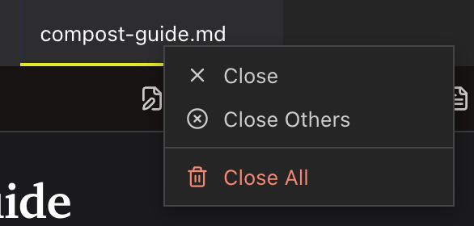
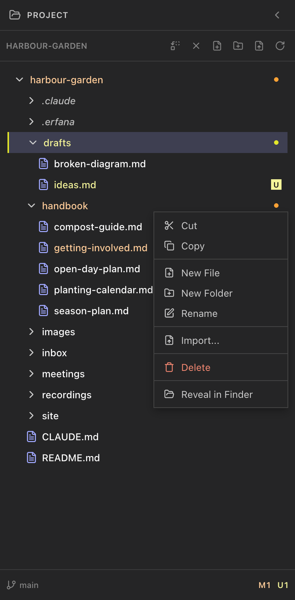
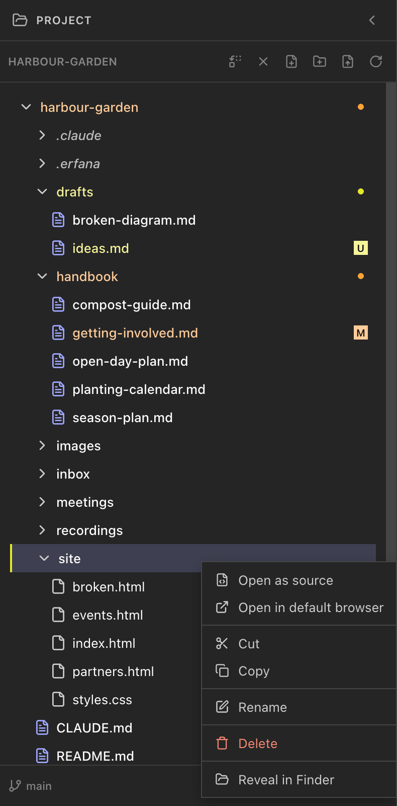

<!--
SPDX-License-Identifier: GPL-3.0-only
SPDX-FileCopyrightText: 2025-2026 Qodeca sp. z o.o.
-->

# Use menus

The app menu provides window, editing and view commands. Right-click menus act on the tab, tree item or selected text beneath the pointer; unavailable actions are disabled. Most right-click menus also open from the keyboard: press <kbd>⇧F10</kbd> / <kbd>Shift+F10</kbd>, or the <kbd>Menu</kbd> key, on the focused tab, tree row, editor, terminal or text field, then use the arrow keys and <kbd>Enter</kbd> – see [keyboard shortcuts](keyboard-shortcuts.md#menus).

**On this page**

- [Erfana menu (macOS)](#erfana-menu-macos)
- [File menu](#file-menu)
- [Edit menu](#edit-menu)
- [View menu](#view-menu)
- [Window menu](#window-menu)
- [Tab context menu](#tab-context-menu)
- [Project tree context menus](#project-tree-context-menus)
- [Editor and preview context menus](#editor-and-preview-context-menus)
- [Terminal and text-box context menus](#terminal-and-text-box-context-menus)

## Erfana menu (macOS)

**What it does:** **About** shows app information; **Hide**, **Hide Others** and **Show All** use macOS window management, and **Quit** quits the app. **How to reach it:** the **Erfana** menu in the system menu bar. **Limits:** macOS only; Windows puts **Exit** in **File**.

## File menu

**What it does:** **New Window** opens another Erfana window; on Windows, **Exit** quits the app. **How to reach it:** **File > New Window**, <kbd>⇧⌘N</kbd> / <kbd>Ctrl+Shift+N</kbd>. Opening a project that is already open in another window focuses that window instead.

## Edit menu

**What it does:** **Undo**, **Redo**, **Cut**, **Copy**, **Paste**, and **Select All** act on the focused editable control. **How to reach it:** **Edit** in the app menu. The actions are Electron's platform roles, so their available accelerators follow the operating system.

## View menu

**What it does:** **Reload** and **Force Reload** redraw the app; **Toggle Developer Tools** opens or closes developer tools; **Actual Size**, **Zoom In**, **Zoom Out** change zoom; **Toggle Full Screen** changes the window display. **How to reach it:** **View**. Zoom keys are <kbd>⌘0</kbd>, <kbd>⌘+</kbd>, <kbd>⌘-</kbd> / <kbd>Ctrl+0</kbd>, <kbd>Ctrl++</kbd>, <kbd>Ctrl+-</kbd>. When an HTML page has focus, zoom applies to that page first.

## Window menu

**What it does:** **Minimize** and **Zoom** manage the window; macOS also has **Bring All to Front**, while Windows has **Close**. **How to reach it:** **Window** in the app menu. Platform window-management keys follow the operating system.

## Tab context menu

**What it does:** **Close** closes this tab, **Close Others** closes the other tabs, and **Close All** closes all tabs. **How to reach it:** right-click a tab. Tabs with unsaved changes show a confirmation before closing.

## Project tree context menus

**What they do:** Folder menus offer **Cut**, **Copy**, **Paste** (when the clipboard has items), **New File**, **New Folder**, **Rename**, **Import...**, **Delete**, and **Reveal in Finder** or **Reveal in Explorer**. File menus offer **Cut**, **Copy**, **Paste** (when the clipboard has items – it pastes into the file's folder), **Rename**, **Delete**, and the same platform-specific **Reveal** action. **Cut**, **Copy**, **Paste** and **Delete** show their shortcuts; the project folder's own row shows none, because those keys do not act on it. The HTML-file menu also offers **Open as source** and **Open in default browser**. **How to reach them:** right-click a file or folder in the tree. **Delete** asks for confirmation because it cannot be undone. Erfana removes the item from disk straight away; it does not go to the Trash on macOS or the Recycle Bin on Windows. Deleting a folder also removes everything inside it.

Related issues: [#431](https://github.com/qodeca/erfana/issues/431).

## Editor and preview context menus

**What they do:** With selected text, both menus offer **Explain**, **Modify**, **Ask**, **Visualize**, and **Prompt**; the editor also offers **Cut**, **Copy**, **Paste**, **Delete**, while Markdown Preview offers **Copy selection**. The clipboard items show their shortcuts. The prompt actions send text to the agent running in the terminal. **How to reach them:** right-click in the editor or preview. Without a selection both menus still open, with the items that need one greyed out. See [prompt templates](prompt-templates.md).

In HTML Preview, the right-click menu lists the comment items, then **Copy selection** <kbd>⌘C</kbd> / <kbd>Ctrl+C</kbd>, which copies the words you right-clicked. It is greyed out when you did not right-click on selected words. The page is read-only, so there is no Cut, Paste or Delete. This menu appears only while comments are turned on in [Settings > Comments](settings.md#comments).

## Terminal and text-box context menus

**What they do:** The terminal menu offers **Copy** and **Paste**; every text field – in dialogs, Settings, the search bar and comment boxes – offers **Cut**, **Copy**, **Paste**, and **Delete**, with their shortcuts. **Delete** removes the selected text without copying it. **How to reach them:** right-click in the relevant control, or press <kbd>⇧F10</kbd> / <kbd>Shift+F10</kbd> in a text field. Cut, Copy and Delete require a selection; a read-only field offers only **Copy**, and a password field never offers **Cut** or **Copy**.
