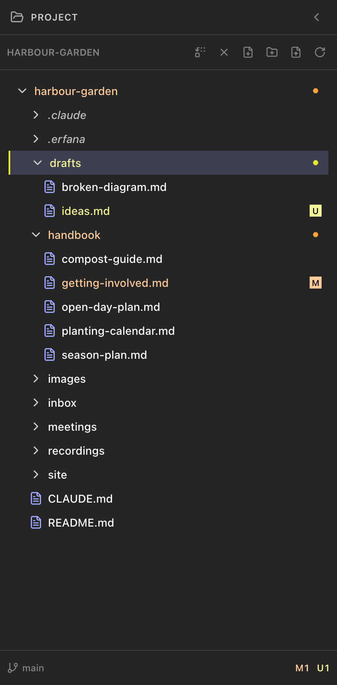

<!--
SPDX-License-Identifier: GPL-3.0-only
SPDX-FileCopyrightText: 2025-2026 Qodeca sp. z o.o.
-->

# Use the project tree

The left project panel shows files and folders in the open project. It offers creation, import, filtering and Git status, and works with the mouse or the keyboard.

**On this page**

- [Toolbar and filter](#toolbar-and-filter)
- [Git badges and status](#git-badges-and-status)
- [Special files and visibility](#special-files-and-visibility)
- [File actions](#file-actions)
- [Keyboard navigation](#keyboard-navigation)

## Toolbar and filter

**What they do:** **New markdown file**, **New folder**, **Import** and **Refresh** act on the tree or selected folder. The filter switches between **All Files** and **Markdown Only**. **How to reach them:** Project panel toolbar and filter control. Select a folder before importing with <kbd>Cmd</kbd>+<kbd>Shift</kbd>+<kbd>I</kbd> (Windows: <kbd>Ctrl</kbd>+<kbd>Shift</kbd>+<kbd>I</kbd>); refresh with <kbd>Cmd</kbd>+<kbd>Alt</kbd>+<kbd>R</kbd> (Windows: <kbd>Ctrl</kbd>+<kbd>Alt</kbd>+<kbd>R</kbd>).

## Git badges and status

**What they do:** File and folder badges show changed or untracked content. The status bar shows the branch and **Clean** when there are no changes; it also handles detached HEAD. **How to reach them:** Open a Git project. Git status has a 10,000-file cap; on large trees, status can be limited. Polling fallback and interval are in [Settings](settings.md#git-status).

## Special files and visibility

**What they do:** Sensitive-file and symlink icons distinguish those entries. Hidden patterns in `.erfana/settings.json` can extend or replace the built-in tree list; the watcher has its own ignore list. **How to reach them:** See [per-project settings](settings.md#per-project-settings). A hidden tree item may still exist on disk.

## File actions

**What they do:** Drag an item to another folder to move it; use Cut, Copy and Paste for file operations. Drop from Finder or File Explorer and choose **Move**, **Copy** or **Import**. A name clash offers **Skip**, **Keep both** or **Replace**; deletion requires confirmation. **How to reach them:** Drag onto the tree or use the [file and folder menus](menus.md#project-tree-context-menus). **Reveal in Finder** is labeled **Reveal in Explorer** on Windows.

## Keyboard navigation

**What it does:** The tree is one stop in the <kbd>Tab</kbd> order. Inside it, the arrow keys move between rows and open or close folders, <kbd>Enter</kbd> opens a file or opens and selects a folder, and typing the first letters of a name jumps to it. <kbd>Shift</kbd>+<kbd>F10</kbd> opens the focused row's menu. **How to reach it:** Press <kbd>Tab</kbd> until the tree has focus; the full list is in [keyboard shortcuts](keyboard-shortcuts.md#project-tree). Moving with the arrows does not change the selected folder; <kbd>Enter</kbd> does. Inside the menu the arrow keys do not work yet ([issue #90](https://github.com/qodeca/erfana/issues/90)).
