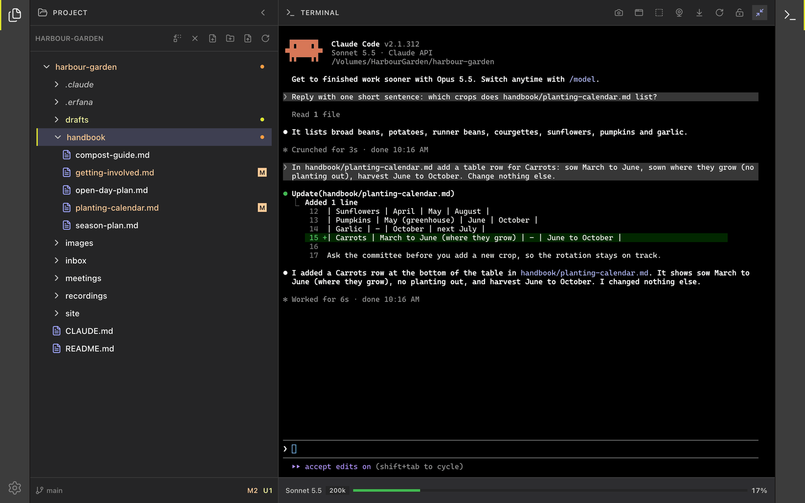

<!--
SPDX-License-Identifier: GPL-3.0-only
SPDX-FileCopyrightText: 2025-2026 Qodeca sp. z o.o.
-->

# Use the terminal

The integrated terminal runs your shell and any CLI agent you start. Erfana hosts the terminal session; prompts and edits come from the agent you choose to run.

**On this page**

- [Opening and session state](#opening-and-session-state)
- [Header controls](#header-controls)
- [Capture controls](#capture-controls)
- [File links and dropped files](#file-links-and-dropped-files)
- [Web links](#web-links)
- [Copy and paste](#copy-and-paste)

## Opening and session state

**What it does:** A terminal opens when a project loads. If you close it yourself, it stays closed during that project; loading another project opens it again. **How to reach it:** the **Terminal** button on the right activity bar, or <kbd>⌘J</kbd> / <kbd>Ctrl+J</kbd>. A shell starts in the project context. If unavailable, the panel offers [recovery controls](troubleshooting.md#terminal-not-available).

## Header controls

**What they do:** **Scroll to bottom** jumps to the latest output; **Restart terminal** starts a new terminal session; **Lock scroll to bottom** keeps new output in view, while **Disable scroll lock** lets you scroll back; **Maximize terminal** expands it over the editor. **How to reach them:** terminal header. When it is too narrow, **Lock scroll to bottom**, **Restart terminal** and **Scroll to bottom** are the first to move into its **More actions** (…) menu. <kbd>⇧⌘M</kbd> / <kbd>Ctrl+Shift+M</kbd> maximizes it, opening the terminal if closed. Opening a file restores the editor layout. Restarting ends the running shell or agent, so **Restart terminal** asks first (**Restart terminal?**, with focus on **Cancel**) while Claude Code runs there, while the terminal is still producing output after you typed in it, or – on macOS – while any program other than the shell is running. On Windows Erfana cannot see which program is running, so a silent program that has printed nothing for 20 seconds is ended without a question. An idle terminal restarts straight away.

## Capture controls

**What they do:** Capture the screen, a window or an area, or take a camera photo. The resulting file path is inserted into the terminal for the running agent or shell. **How to reach them:** the terminal header buttons **Capture screen**, **Capture window**, **Capture area** and **Capture photo**. Screen capture on macOS can require Screen Recording permission; Windows uses pickers and an area overlay. See [send a screenshot or photo](../how-to/send-a-screenshot-or-photo-to-the-agent.md).

## File links and dropped files

**What they do:** Select a printed project path, including `@path` or a line range such as `:10-20`, to open its file; if several files match, choose in the picker. Dropping a file into the terminal inserts an escaped path. **How to reach them:** terminal output link or drag from the file manager. Image paths open in the image viewer. A path inserted at the prompt is text; submit it only when ready.

## Web links

**What they do:** Selecting an `http` or `https` link in the terminal opens it in a new [browser tab](built-in-browser.md) in the editor area. <kbd>⌘</kbd>-click / <kbd>Ctrl</kbd>-click opens it in your operating system's default browser instead. Any other kind of link goes to your operating system, after Erfana checks it. **How to reach them:** select a web address printed in the terminal.

## Copy and paste

**What it does:** Right-click for **Copy** and **Paste**. On Windows, <kbd>Ctrl+C</kbd> copies a selection but interrupts the running process if nothing is selected. **How to reach it:** terminal context menu – right-click, or press <kbd>⇧F10</kbd> / <kbd>Shift+F10</kbd> (Windows: also the <kbd>Menu</kbd> key) to open it at the terminal cursor – or the [shortcut reference](keyboard-shortcuts.md#terminal).

Pasted text that a web page in a browser tab put on the clipboard asks first when it holds a line break or a control character, because the terminal could run it at once: **Paste text a web page copied?** shows the text with its hidden characters drawn as symbols, and **Paste** types it. Text dragged into the terminal from outside Erfana asks the same way (**Drop text from outside Erfana?**), because Erfana cannot tell a web page from another app. Plain text with neither, and a drag that starts inside Erfana, go straight in.
