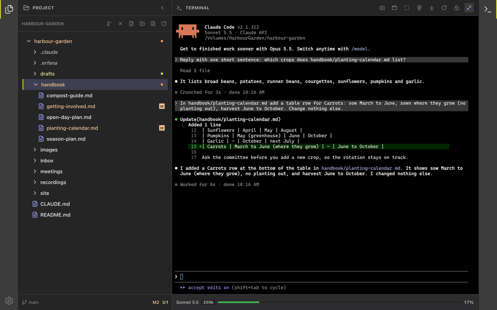

<!--
SPDX-License-Identifier: GPL-3.0-only
SPDX-FileCopyrightText: 2025-2026 Qodeca sp. z o.o.
-->

# Use the terminal

The integrated terminal runs your shell and any CLI agent you start. Erfana hosts the terminal session; prompts and edits come from the agent you choose to run.

**On this page**

- [Opening and session state](#opening-and-session-state)
- [Header controls](#header-controls)
- [Capture controls](#capture-controls)
- [File links and dropped files](#file-links-and-dropped-files)
- [Copy and paste](#copy-and-paste)
- [Screen readers](#screen-readers)

## Opening and session state

**What it does:** A terminal opens when a project loads. If you close it yourself, it stays closed during that project; loading another project opens it again. **How to reach it:** the right activity bar or <kbd>Cmd</kbd>+<kbd>J</kbd> (Windows: <kbd>Ctrl</kbd>+<kbd>J</kbd>). A shell starts in the project context. If unavailable, the panel offers [recovery controls](troubleshooting.md#terminal-not-available).

## Header controls

**What they do:** **Scroll to bottom** jumps to the latest output; **Restart terminal** starts a new terminal session; **Lock scroll to bottom** keeps new output in view, while **Disable scroll lock** lets you scroll back; **Maximize terminal** expands it over the editor. **How to reach them:** terminal header. <kbd>Cmd</kbd>+<kbd>Shift</kbd>+<kbd>M</kbd> (Windows: <kbd>Ctrl</kbd>+<kbd>Shift</kbd>+<kbd>M</kbd>) maximizes it, opening the terminal if closed. Opening a file restores the editor layout. Restarting ends the running shell or agent, so **Restart terminal** asks first (**Restart terminal?**, with focus on **Cancel**) while Claude Code runs there, while the terminal is still producing output after you typed in it, or – on macOS – while any program other than the shell is running. On Windows Erfana cannot see which program is running, so a silent program that has printed nothing for a while is ended without a question. An idle terminal restarts straight away.

## Capture controls

**What they do:** Capture the screen, a window or an area, or take a camera photo. The resulting file path is inserted into the terminal for the running agent or shell. **How to reach them:** terminal header capture buttons. Screen capture on macOS can require Screen Recording permission; Windows uses pickers and an area overlay. See [send a screenshot or photo](../how-to/send-a-screenshot-or-photo-to-the-agent.md).

## File links and dropped files

**What they do:** Select a printed project path, including `@path` or a line range such as `:10-20`, to open its file; if several files match, choose in the picker. Dropping a file into the terminal inserts an escaped path. **How to reach them:** terminal output link or drag from the file manager. Image paths open in the image viewer. A path inserted at the prompt is text; submit it only when ready.

## Copy and paste

**What it does:** Right-click for **Copy** and **Paste**. On Windows, <kbd>Ctrl</kbd>+<kbd>C</kbd> copies a selection but interrupts the running process if nothing is selected. **How to reach it:** terminal context menu – right-click, or press <kbd>Shift</kbd>+<kbd>F10</kbd> (Windows: also the <kbd>Menu</kbd> key) to open it at the terminal cursor – or the [shortcut reference](keyboard-shortcuts.md#terminal).

## Screen readers

**What it does:** The terminal draws its text as a picture, so a screen reader reads it only in screen-reader mode. Erfana turns that mode on while macOS or Windows reports a screen reader such as VoiceOver or NVDA. **How to reach it:** automatic; to force it on or off, use **Settings > Terminal > Screen reader mode** ([settings](settings.md#terminal)). A change applies to open terminals at once.
