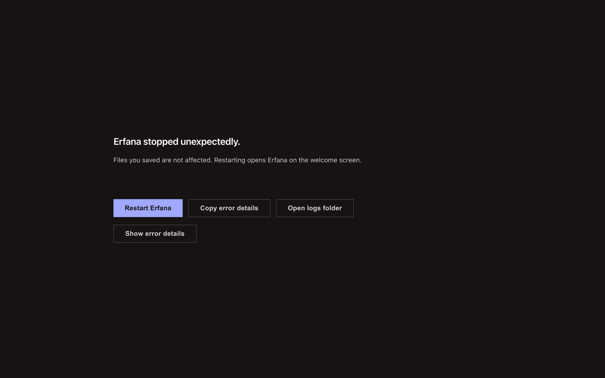
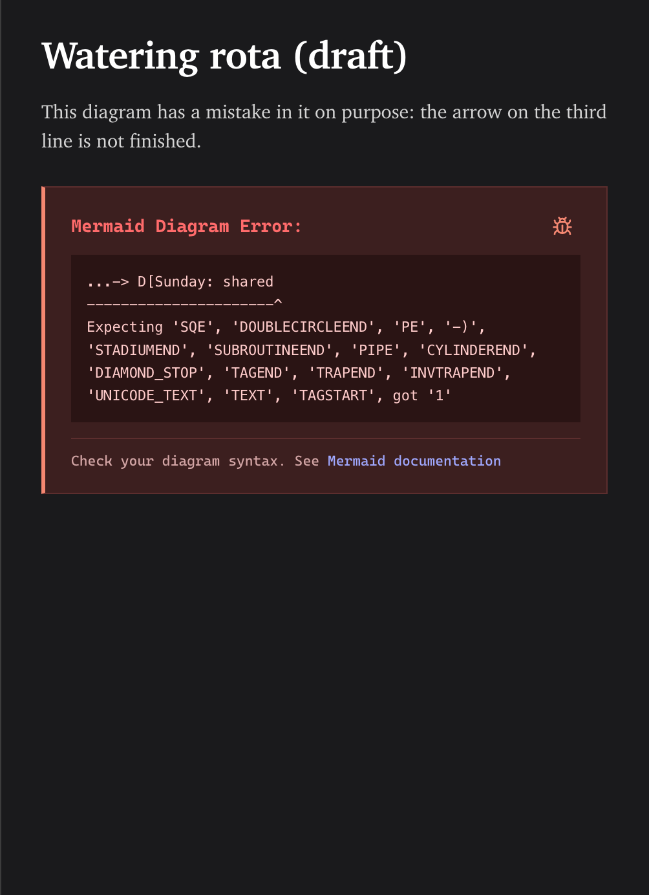

<!--
SPDX-License-Identifier: GPL-3.0-only
SPDX-FileCopyrightText: 2025-2026 Qodeca sp. z o.o.
-->

# Recover from problems

Erfana shows a recovery screen or a local panel message when a part of the interface fails. Saved project files remain on disk; an unsaved editor buffer can be lost after a whole-window crash.

**On this page**

- [Erfana stopped unexpectedly](#erfana-stopped-unexpectedly)
- [A folder cannot be opened as a project](#a-folder-cannot-be-opened-as-a-project)
- [Project tree unavailable](#project-tree-unavailable)
- [Panel unavailable](#panel-unavailable)
- [Terminal not available](#terminal-not-available)
- [HTML preview stopped or reports issues](#html-preview-stopped-or-reports-issues)
- [Mermaid diagram rendering error](#mermaid-diagram-rendering-error)
- [File changed on disk](#file-changed-on-disk)
- [Office documents cannot be imported](#office-documents-cannot-be-imported)
- [Error messages](#error-messages)

## Erfana stopped unexpectedly

**What it does:** The crash screen contains a renderer failure and offers **Restart Erfana**, **Open logs folder**, and **Copy error details**. **How to reach it:** It appears after a whole-window rendering error; it is not a menu command. Copy the details into a bug report, open the logs for more context, then restart. Restart returns to the welcome screen and does not reopen the last project automatically. If Restart has no effect after about three seconds, quit and reopen the app. If the bridge to the main process failed, the screen may show instructions without buttons.

## A folder cannot be opened as a project

**What it does:** Erfana refuses a folder that would put too much of the computer inside the project, and says why in plain words. **How to reach it:** It appears when you open a folder from the dialog, the recent list or by dropping it. The top of a drive or volume (such as `/` or `C:\`), the top of a network share, system folders (on Windows the Windows, Program Files and ProgramData folders) and folders such as `.ssh` or `.aws` are refused, and so is a link or shortcut that leads to one. Open the subfolder that holds your work instead.

## Project tree unavailable

**What it does:** A tree error stays in the left panel while editor tabs and terminal can continue. **How to reach it:** The panel displays **Project tree unavailable** and a **Reload** button when drawing fails. Select **Reload**; if it repeats, open a different project or collect `combined.log` from **Settings > Logging > Open** for a bug report. A new project gets a fresh tree.

## Panel unavailable

**What it does:** A failed panel shows an unavailable message and **Reload** rather than taking down the window. **How to reach it:** It appears in that panel after an error. Reload the panel; if it fails again, collect the logs. The rest of the app can remain usable.

## Terminal not available

**What it does:** The terminal status panel reports that the terminal backend is unavailable. **How to reach it:** Open Terminal with the right activity bar or <kbd>⌘J</kbd> / <kbd>Ctrl+J</kbd>. Select **Recheck** after addressing the displayed cause; **Copy fix command** copies the suggested command for an installed development build. If the terminal still cannot start, include its message and log in a report. A **Terminal error** panel shows why the shell could not start in this project, for example a path Windows cannot start a shell in; open another project and the terminal starts again there.

## HTML preview stopped or reports issues

**What it does:** A stopped preview offers **Reload**. The **Preview issues** list names script failures, blocked remote hosts, links and frames. **How to reach it:** Open an HTML file; use the toolbar's issues control or the stopped-preview **Reload** action. Check the listed issue, correct the project file, and reload. A blocked remote host requires an explicit [permission](html-preview.md#remote-host-permission); a file in a protected build folder opens as source instead.

## Mermaid diagram rendering error

**What it does:** Invalid diagram syntax shows an error box instead of a diagram. **How to reach it:** Open Markdown Preview on a file with a Mermaid block. Check syntax and diagram type; the bug icon labeled **Report this error to Claude Code** sends a document-changing prompt to the terminal. With an agent running, it can edit the source file in place. Review those edits before saving or relying on them.

## File changed on disk

**What it does:** A conflict notice appears if the file changed outside Erfana while the editor has local changes. **How to reach it:** Select **Reload from Disk** to use the external version or **Keep My Version** to retain the editor buffer. Check both versions before choosing if you need to preserve edits. While the notice is showing, autosave waits for your choice instead of writing over the newer file. See [edit and preview Markdown](../how-to/edit-and-preview-markdown.md).

## Office documents cannot be imported

**What it does:** A **LibreOffice required** message appears when you import a Word, PowerPoint, Excel or OpenDocument file and LibreOffice was not found; **LibreOffice in an unsafe location** appears when the only copy Erfana found is one it will not run. **How to reach it:** Select **Open import tools** in the message, or open **Settings > Import tools**. Follow the install hint there, then choose **Check again**. PDF and image imports never need LibreOffice. See [Import tools](settings.md#import-tools).

## Error messages

**What it does:** Short messages (toasts) report results and problems. An error, or a message with a button, stays until you close it; a warning stays at least 8 seconds; other messages close on their own. A message never closes while the pointer is over it or keyboard focus is inside it. **How to reach it:** Press <kbd>Esc</kbd> on a focused message to close it. The same error raised again adds a count such as "×3" to the message already shown, and at most five messages that wait to be closed are shown at once – the oldest one goes first.
